# Tư liệu hoạt ảnh 4×4 — Linh Thú Tam Địa

**Tiến độ: 136/137 hoạt ảnh.**

Mỗi tệp là một bảng 4×4 = 16 khung hình liên tiếp (đọc trái→phải, trên→xuống), 1024×1024, mỗi khung 256×256.

- `img/v16/v_<mã>.webp` — bảng khung hình nền trong suốt (đường dẫn dùng trong app, cạnh `img/v/` hiện có).
- `goc_nen_den/v_<mã>.jpg` — bản gốc nền đen (dùng chế độ hoà trộn sáng / screen).
- `xem_dong/v_<mã>.webp` — ảnh động xem thử 16 khung (70 ms/khung).
- `danh_sach.json` — danh sách mã, nhóm, đường dẫn.

## Sự kiện thường gặp trong trận

| Mã | Bảng 4×4 | Xem động |
|---|---|---|
| `lat_the` | [bảng](img/v16/v_lat_the.webp) |  |
| `tang_suc` | [bảng](img/v16/v_tang_suc.webp) |  |
| `giam_suc` | [bảng](img/v16/v_giam_suc.webp) |  |
| `tieu_diet` | [bảng](img/v16/v_tieu_diet.webp) |  |
| `loai_bo` | [bảng](img/v16/v_loai_bo.webp) |  |
| `di_chuyen` | [bảng](img/v16/v_di_chuyen.webp) |  |
| `rut_bai` | [bảng](img/v16/v_rut_bai.webp) | 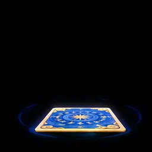 |
| `tao_the` | [bảng](img/v16/v_tao_the.webp) | 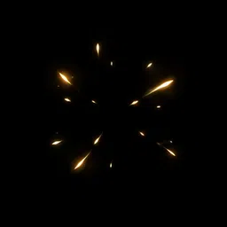 |
| `bien_hinh` | [bảng](img/v16/v_bien_hinh.webp) | 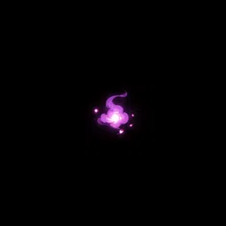 |
| `khoa_dia` | [bảng](img/v16/v_khoa_dia.webp) |  |
| `nang_luong` | [bảng](img/v16/v_nang_luong.webp) |  |
| `nhan_doi` | [bảng](img/v16/v_nhan_doi.webp) |  |
| `sao_chep` | [bảng](img/v16/v_sao_chep.webp) |  |
| `hoi_sinh` | [bảng](img/v16/v_hoi_sinh.webp) |  |
| `thang` | [bảng](img/v16/v_thang.webp) |  |
| `thua` | [bảng](img/v16/v_thua.webp) | 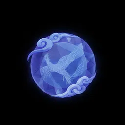 |
| `cuoc_x2` | [bảng](img/v16/v_cuoc_x2.webp) |  |
| `hien_dia` | [bảng](img/v16/v_hien_dia.webp) |  |
| `song_xung` | [bảng](img/v16/v_song_xung.webp) |  |
| `sao_tang` | [bảng](img/v16/v_sao_tang.webp) |  |
| `hut_keo` | [bảng](img/v16/v_hut_keo.webp) |  |
| `khien_chan` | [bảng](img/v16/v_khien_chan.webp) |  |
| `doc_lan` | [bảng](img/v16/v_doc_lan.webp) |  |
| `dong_bang` | [bảng](img/v16/v_dong_bang.webp) | 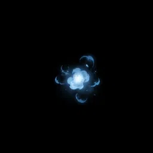 |
| `thieu_dot` | [bảng](img/v16/v_thieu_dot.webp) |  |
| `set_danh` | [bảng](img/v16/v_set_danh.webp) |  |

## Chiêu thức dùng chung

| Mã | Bảng 4×4 | Xem động |
|---|---|---|
| `kiem` | [bảng](img/v16/v_kiem.webp) |  |
| `dao` | [bảng](img/v16/v_dao.webp) |  |
| `ten` | [bảng](img/v16/v_ten.webp) |  |
| `tay` | [bảng](img/v16/v_tay.webp) |  |
| `xich` | [bảng](img/v16/v_xich.webp) |  |
| `bua_chu` | [bảng](img/v16/v_bua_chu.webp) |  |
| `guong` | [bảng](img/v16/v_guong.webp) |  |
| `co` | [bảng](img/v16/v_co.webp) |  |
| `trong` | [bảng](img/v16/v_trong.webp) | 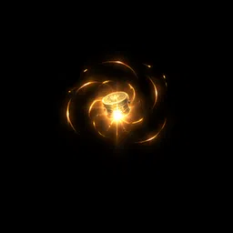 |
| `so` | [bảng](img/v16/v_so.webp) |  |
| `cong` | [bảng](img/v16/v_cong.webp) |  |
| `gio` | [bảng](img/v16/v_gio.webp) |  |
| `lua` | [bảng](img/v16/v_lua.webp) |  |
| `day` | [bảng](img/v16/v_day.webp) | 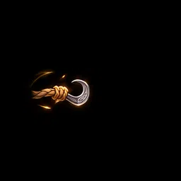 |
| `khien` | [bảng](img/v16/v_khien.webp) |  |
| `ngoc` | [bảng](img/v16/v_ngoc.webp) |  |
| `bua` | [bảng](img/v16/v_bua.webp) |  |

## Va chạm / vụ nổ / vệt chém

| Mã | Bảng 4×4 | Xem động |
|---|---|---|
| `no_lua` | [bảng](img/v16/v_no_lua.webp) |  |
| `no_set` | [bảng](img/v16/v_no_set.webp) |  |
| `no_doc` | [bảng](img/v16/v_no_doc.webp) |  |
| `no_bang` | [bảng](img/v16/v_no_bang.webp) |  |
| `no_sang` | [bảng](img/v16/v_no_sang.webp) | 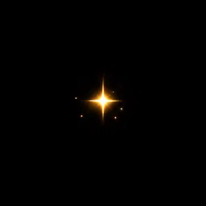 |
| `no_toi` | [bảng](img/v16/v_no_toi.webp) |  |
| `bui_dap` | [bảng](img/v16/v_bui_dap.webp) |  |
| `manh_vo` | [bảng](img/v16/v_manh_vo.webp) |  |
| `vet_chem` | [bảng](img/v16/v_vet_chem.webp) |  |
| `vet_cao` | [bảng](img/v16/v_vet_cao.webp) |  |

## Khung hào quang lá bài (lặp vô hạn)

| Mã | Bảng 4×4 | Xem động |
|---|---|---|
| `khung_lua` | [bảng](img/v16/v_khung_lua.webp) |  |
| `khung_nuoc` | [bảng](img/v16/v_khung_nuoc.webp) |  |
| `khung_set` | [bảng](img/v16/v_khung_set.webp) |  |
| `khung_moc` | [bảng](img/v16/v_khung_moc.webp) |  |

## Chiêu riêng của 80 thẻ

| Mã | Bảng 4×4 | Xem động |
|---|---|---|
| `kiemnuuminh` | [bảng](img/v16/v_kiemnuuminh.webp) |  |
| `nuloithan` | [bảng](img/v16/v_nuloithan.webp) | 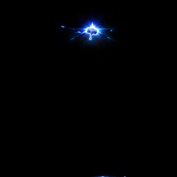 |
| `tonu` | [bảng](img/v16/v_tonu.webp) |  |
| `nuthantien` | [bảng](img/v16/v_nuthantien.webp) | 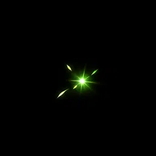 |
| `bangca` | [bảng](img/v16/v_bangca.webp) |  |
| `kenuotsao` | [bảng](img/v16/v_kenuotsao.webp) |  |
| `maynuotthoigian` | [bảng](img/v16/v_maynuotthoigian.webp) |  |
| `nghichtuvuong` | [bảng](img/v16/v_nghichtuvuong.webp) |  |
| `nuloimienvien` | [bảng](img/v16/v_nuloimienvien.webp) |  |
| `thuanung` | [bảng](img/v16/v_thuanung.webp) |  |
| `satvuong` | [bảng](img/v16/v_satvuong.webp) |  |
| `baonu` | [bảng](img/v16/v_baonu.webp) |  |
| `channu` | [bảng](img/v16/v_channu.webp) |  |
| `bavuongmienvien` | [bảng](img/v16/v_bavuongmienvien.webp) |  |
| `aosi` | [bảng](img/v16/v_aosi.webp) |  |
| `baochuahauthe` | [bảng](img/v16/v_baochuahauthe.webp) | 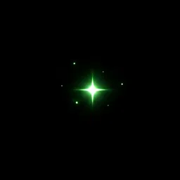 |
| `chonvacay` | [bảng](img/v16/v_chonvacay.webp) | 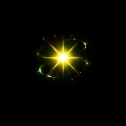 |
| `chutruongnu` | [bảng](img/v16/v_chutruongnu.webp) |  |
| `dakhuc` | [bảng](img/v16/v_dakhuc.webp) |  |
| `docnutrang` | [bảng](img/v16/v_docnutrang.webp) |  |
| `hongtam` | [bảng](img/v16/v_hongtam.webp) |  |
| `huyetmenu` | [bảng](img/v16/v_huyetmenu.webp) |  |
| `kiemquyen` | [bảng](img/v16/v_kiemquyen.webp) |  |
| `kysidichkhuyen` | [bảng](img/v16/v_kysidichkhuyen.webp) |  |
| `langthan` | [bảng](img/v16/v_langthan.webp) |  |
| `matocvutru` | [bảng](img/v16/v_matocvutru.webp) |  |
| `namtuocmatna` | [bảng](img/v16/v_namtuocmatna.webp) |  |
| `nhannhenquai` | [bảng](img/v16/v_nhannhenquai.webp) |  |
| `nhendotham` | [bảng](img/v16/v_nhendotham.webp) |  |
| `nuhongtam` | [bảng](img/v16/v_nuhongtam.webp) |  |
| `phonglinhnu` | [bảng](img/v16/v_phonglinhnu.webp) |  |
| `saotrongdau` | [bảng](img/v16/v_saotrongdau.webp) | 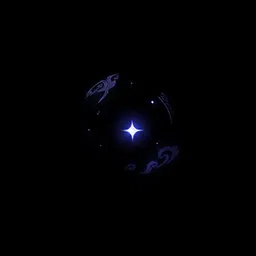 |
| `tamlinhtu` | [bảng](img/v16/v_tamlinhtu.webp) | 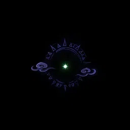 |
| `thetdich` | [bảng](img/v16/v_thetdich.webp) |  |
| `thuyhau` | [bảng](img/v16/v_thuyhau.webp) |  |
| `tieulong` | [bảng](img/v16/v_tieulong.webp) |  |
| `virutcosinh` | [bảng](img/v16/v_virutcosinh.webp) |  |
| `hoavatnu` | [bảng](img/v16/v_hoavatnu.webp) |  |
| `longbattu` | [bảng](img/v16/v_longbattu.webp) |  |
| `bachho` | [bảng](img/v16/v_bachho.webp) |  |
| `mehoacnu` | [bảng](img/v16/v_mehoacnu.webp) |  |
| `quyensu` | [bảng](img/v16/v_quyensu.webp) |  |
| `cohoang` | [bảng](img/v16/v_cohoang.webp) |  |
| `cunemthantoc` | [bảng](img/v16/v_cunemthantoc.webp) |  |
| `linhgaccuoi` | [bảng](img/v16/v_linhgaccuoi.webp) |  |
| `bangvuong` | [bảng](img/v16/v_bangvuong.webp) |  |
| `cotnu` | [bảng](img/v16/v_cotnu.webp) |  |
| `cucquang` | [bảng](img/v16/v_cucquang.webp) |  |
| `culongco` | [bảng](img/v16/v_culongco.webp) | 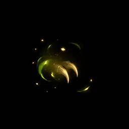 |
| `hongve` | [bảng](img/v16/v_hongve.webp) |  |
| `kysivuottu` | [bảng](img/v16/v_kysivuottu.webp) |  |
| `tuthanmienvien` | [bảng](img/v16/v_tuthanmienvien.webp) | 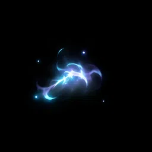 |
| `quangpho` | [bảng](img/v16/v_quangpho.webp) |  |
| `nhennu` | [bảng](img/v16/v_nhennu.webp) |  |
| `thukieu` | [bảng](img/v16/v_thukieu.webp) |  |
| `batkhacan` | [bảng](img/v16/v_batkhacan.webp) | 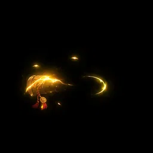 |
| `kiemlongnhan` | [bảng](img/v16/v_kiemlongnhan.webp) | 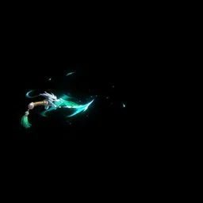 |
| `tutraonu` | [bảng](img/v16/v_tutraonu.webp) | 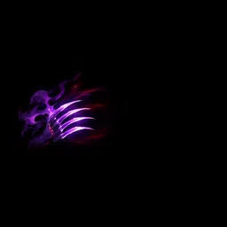 |
| `bato` | [bảng](img/v16/v_bato.webp) |  |
| `huyetdichhangxom` | [bảng](img/v16/v_huyetdichhangxom.webp) |  |
| `nhenhacdich` | [bảng](img/v16/v_nhenhacdich.webp) |  |
| `nhenngaymoi` | [bảng](img/v16/v_nhenngaymoi.webp) |  |
| `nhennon` | [bảng](img/v16/v_nhennon.webp) |  |
| `batty` | [bảng](img/v16/v_batty.webp) | 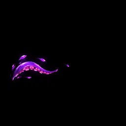 |
| `nhennhan` | [bảng](img/v16/v_nhennhan.webp) | 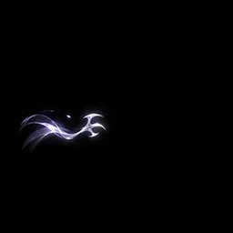 |
| `phongnu` | [bảng](img/v16/v_phongnu.webp) | 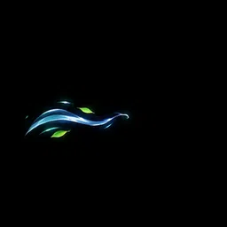 |
| `tunu` | [bảng](img/v16/v_tunu.webp) |  |
| `chomay` | [bảng](img/v16/v_chomay.webp) |  |
| `cuongdomienvien` | [bảng](img/v16/v_cuongdomienvien.webp) |  |
| `kysibaitu` | [bảng](img/v16/v_kysibaitu.webp) | 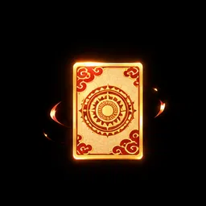 |
| `kysinguyetyeu` | [bảng](img/v16/v_kysinguyetyeu.webp) |  |
| `nhennoiloan` | [bảng](img/v16/v_nhennoiloan.webp) |  |
| `thachquaisokhai` | [bảng](img/v16/v_thachquaisokhai.webp) |  |
| `thiettam` | [bảng](img/v16/v_thiettam.webp) |  |
| `hongphuthuy` | [bảng](img/v16/v_hongphuthuy.webp) |  |
| `songchuynu` | [bảng](img/v16/v_songchuynu.webp) | 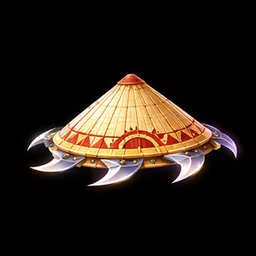 |
| `socnu` | [bảng](img/v16/v_socnu.webp) |  |
| `baithu` | _đang vẽ_ | |
| `daudanthieunu` | [bảng](img/v16/v_daudanthieunu.webp) | 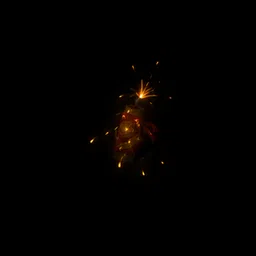 |
| `phonghiem` | [bảng](img/v16/v_phonghiem.webp) |  |

## Toàn bộ ảnh game (đúng đường dẫn trong app)

| Thư mục | Nội dung | Số ảnh |
|---|---|---|
| [`img/c/`](img/c) | Ảnh thẻ bài, tên tệp = mã thẻ | 585 |
| [`img/l/`](img/l) | Ảnh chiến địa | 120 |
| [`img/a/`](img/a) | Nền đấu trường | 10 |
| [`img/u/`](img/u) | Giao diện (gói thẻ, rương, chế độ...) và 28 mặt lưng mới `bk_*` (chưa gắn vào game) | 50 |
| [`img/v/`](img/v) | Vật thể chiêu thức 1 khung đang dùng trong game (toàn bộ vẽ bằng ChatGPT; 41 hiệu ứng chung và 22 ảnh giao diện đã vẽ lại 16/11 thay ảnh Google Flow) | 121 |
| [`img/v16/`](img/v16) | Hoạt ảnh 4×4 mới (bảng trên) | 136 |
| [`anh_goc_chatgpt/`](anh_goc_chatgpt) | Ảnh lưới GỐC ChatGPT chưa cắt (thẻ, chiến địa, mặt lưng, giao diện, hiệu ứng) — xem README trong thư mục | 225 |

Đã kiểm: không có hai tệp nào trùng nội dung trong thư mục này. Không gồm bảng ghép `img/s` và ảnh thu nhỏ (chỉ là bản ghép lại của `img/c`).
